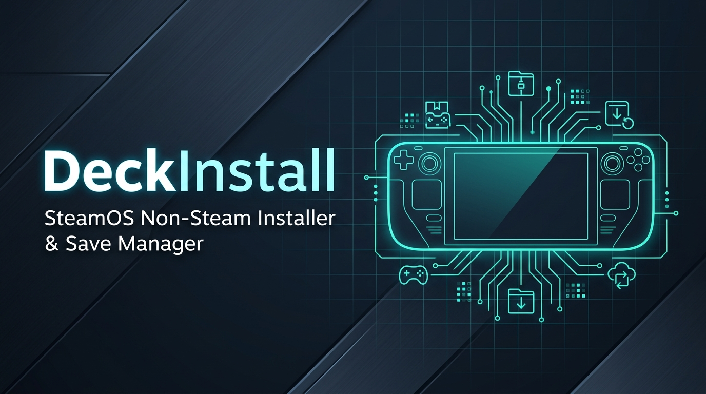

# DeckInstall

Non-Steam game installer, Proton prefix migrator, save validator, and official Steam artwork manager for **Steam Deck / SteamOS** (KDE Plasma + Qt6).

**Current version:** `0.7.7`

## Features
- **Extract & Install**: Extracts `.zip`, `.rar`, `.7z`, and `.tar.*` into `~/Games/<Game>` (automatically unwrapping nested single root folders and merging without wiping existing files), or runs Windows `setup.exe` installers via Proton and automatically adopts the resulting `.deckinstall_installer_pfx` prefix into Steam `compatdata`.
- **Smart Game Detection**: Scans `~/Games`, `~/Downloads`, `~/Syncthing`, and SD cards (`/run/media/*`), skipping helper/redistributable binaries to highlight the real game executable while reading validated `steam_appid.txt` (`1..4294967295`) and emulator metadata.
- **Transactional Steam Shortcuts & Proton Control**: Safely manages `shortcuts.vdf` and `config.vdf` under file locking (`flock`), preserves existing `LaunchOptions`, `icon`, and Proton tool mappings, migrates `compatdata`/grid assets when paths change, and disables VDF writes with a warning banner if `shortcuts.vdf` is corrupted.
- **Bulk Migration & Multi-Launcher Save Sync**: Moves games from `~/Downloads` into `~/Games` across Steam users with multi-user rollback, imports newer/missing saves from **Hydra**, **Heroic**, **Lutris**, **Bottles**, and **UMU** prefixes (with symlink-escape guards), and supports full ZIP save backup & restore.
- **Verified Prefix Cleanup**: Lists external prefixes, `.deckinstall.bak` backups, and orphan `compatdata` folders with inferred game names, verifying file integrity (`SHA-256`, size, mtime, and unconventional `drive_c` save scan) and protecting active Steam shortcuts before deletion.
- **Launch Presets & Official Steam Artwork**: One-click toggles for `gamemoderun`, `mangohud`, `PROTON_USE_WINED3D`, `PROTON_NO_ESYNC`, and `PROTON_NO_FSYNC`; Steam Store search and direct AppID lookup (with Flatpak/native warning); and `.deckinstall_art_bak/` backup for one-click **Revert Artwork**.
- **Themes & Internationalization (i18n)**: Supports **Auto**, **Dark**, and **Light** themes, with JSON-based localization (`src/deckinstall/locales/en.json` and `pt_BR.json`).

## Quick Start (AppImage)
Download `DeckInstall-<version>-x86_64.AppImage` from [GitHub Releases](https://github.com/murilogiatti/DeckInstall/releases):

```bash
chmod +x DeckInstall-0.7.7-x86_64.AppImage
./DeckInstall-0.7.7-x86_64.AppImage --version
QT_QPA_PLATFORM=offscreen ./DeckInstall-0.7.7-x86_64.AppImage --smoke-test
./DeckInstall-0.7.7-x86_64.AppImage
```

## Translating DeckInstall
English (`en`) is the primary language. To add a new translation:
1. Copy [`src/deckinstall/locales/en.json`](src/deckinstall/locales/en.json) to `src/deckinstall/locales/<locale>.json` (e.g. `es.json`, `fr.json`, `de.json`, `ja.json`).
2. Translate the values while keeping all `{placeholders}` intact.
3. DeckInstall automatically detects new `*.json` files in `locales/` and lists them in the **Language** selector.

## Local Development
```bash
python3 -m venv .venv
source .venv/bin/activate
pip install -r requirements.txt
python main.py
```

Run unit tests (strict `ResourceWarning` + headless Qt):
```bash
QT_QPA_PLATFORM=offscreen PYTHONPATH=src python3 -W error::ResourceWarning -m unittest discover -s tests -v
```

## Build AppImage (GitHub Actions)
Push a semantic tag matching `VERSION` (e.g. `v0.7.7`) to automatically run the test suite, compile a standalone binary with Nuitka, smoke-test the packaged `AppDir`, build `DeckInstall-<version>-x86_64.AppImage`, and attach it to the GitHub Release.

## License
Distributed under the [MIT License](LICENSE).
